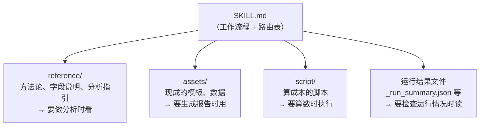
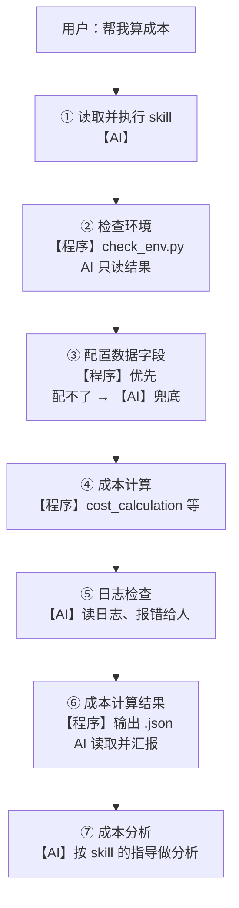

#### 4.4.2 先做一个最简单的 skill：序时账抽样

在讲"怎么设计"之前，我们先**做一个**。

而且**不设计、先做**——先做一个能跑的最低版本，跑一次，看它哪里不对。**它不对的地方，就是设计要点。**

**任务：抽凭。** 给一份序时账，从里面抽 30 笔凭证出来检查。这是审计最日常的动作之一。

我们手上有一份某客户的序时账（2025 年 1 月）：**6,566 行分录、1,301 张凭证，借贷各 5.06 亿**。

> ⚠️ **数据说明**：这是一份**真实客户的序时账**，课件里下面的数字都是它跑出来的真结果。但**摘要里的往来单位名称已做脱敏**——客户名、供应商名、员工姓名一律换成代号。金额、凭证编号、笔数这些照实。
>
> 在我们这行，这本来就是常识：**给外人看数据之前先脱敏。** 课件要公开推到 GitHub，更是如此——`.gitignore` 只能挡住原始 Excel 文件，**挡不住你贴进正文里的那些字**。

##### 第一版：只有 SKILL.md 的"裸提示词版"

3.4 说过：SKILL.md 说白了就是一段提示词。

那我们就先写这一段，**别的什么都不加**——没有脚本、没有参考文件、没有模板。

```markdown
---
name: voucher-sampling
description: 从序时账里抽取凭证样本，输出抽样清单和抽样说明。当用户说"抽凭""抽样""抽几笔凭证看看"时使用。
---

# 序时账抽样

## 输入
一份序时账（Excel / CSV）。

## 步骤
1. 读入序时账，看看一共有多少笔
2. 按金额分层
3. 每层抽几笔
4. 把抽到的写成一个清单
5. 哪些看起来可疑，标出来
6. 写一段抽样说明

## 输出
抽样清单、抽样说明
```

就这 20 行，存成 `.dsh/skills/voucher-sampling/SKILL.md`，然后对 AI 说一句话：

```text
帮我抽 30 笔凭证
```

**它确实干活了，而且干得挺像样**——给了清单、给了分层、给了覆盖率，还"发现"了几笔可疑凭证，措辞完全像一份能进底稿的东西。

为了不被"看起来对"骗过去，我们**真的把这份 20 行的 skill 交给一个干净的 AI 跑了一遍**。为了排除干扰，我们额外加了一条约束：**只读、不许发挥、如实汇报自己做了什么**。

> 先记一句实话：**这次它跑得算干净，很大程度是因为有这条约束。而这条约束并不在 skill 里。** 换句话说，我们靠"人肉补充规矩"替 skill 兜了底——这正是下面所有问题的根源。

下面是它实际做的事：

| SKILL.md 里写的 | 实际跑起来发生了什么 |
| --- | --- |
| 1. 读入序时账，看看一共有多少笔 | **"笔"是行还是凭证？没定义。** 它先数出 6,566 行，又觉得该按凭证算成 1,301 张——两个口径全靠它现场选 |
| 2. 按金额分层 | **阈值、层数、边界，一个都没给。** 它自己拍成 4 层（1 万 / 10 万 / 100 万），依据是它自己算的分位数；它自己说"换个人会取别的"。顺带把 28 笔负数金额、23 笔零金额也塞进了第一层——**这同样是它自己决定的** |
| 3. 每层抽几笔 | **分配规则完全没有。** 它按"层内笔数占比 × 30"分配成 11 / 11 / 6 / 2。于是——**占全月金额 81.3% 的大额层，只抽到 2 笔**；它自己承认"这个选择在专业上站不住" |
| 4. 把抽到的写成一个清单 | 写到哪、含哪些字段、要不要落盘？**都没说** |
| 5. 哪些看起来可疑，标出来 | **判据零条。** 它自己发明了一套（金额为负、摘要含"现金"、摘要提到"2 月开票"），还自己划了范围：只在样本里找，不筛全账套 |
| 6. 写一段抽样说明 | 要不要含方法、覆盖率、局限性？**没说**——它自己补了一份八条的说明，还额外加了"局限性"一节，写的是"**样本不能用于推断总体错报金额**" |

> 看清楚最后一行的意思：**这句免责声明，是它替我们写的。** 因为 skill 里什么规矩都没定，它只能自己定一套，然后自己声明"这套不牢靠"。
>
> 而这份声明如果没写，这个 skill 就会**安安静静地交出一份看起来很正规、实际盖不住风险的抽样结果**。

顺带说一句：它**这次把 sheet 读对了**——但那是运气，不是设计。因为那份 Excel 里恰好有一个 sheet 就叫「序时账」；要是人家导出来的叫「明细」「Sheet1」，它就只剩猜了。

##### 那 V1 好在哪、坏在哪

**一身两样。而且这一好一坏，恰好对应后面两节要讲的两条核心。**

**✅ 好在：它有流程。**

你看那 20 行——"读入 → 分层 → 抽样 → 出清单 → 标可疑 → 写说明"，6 步是有先后的，AI 照着就能一步步走完。

**这就是 4.4.3 要讲的核心一：把 skill 设计成工作流程。** 它至少保证了"这个 skill 能被执行下来"，不会跑到一半不知道下一步该干嘛。3.4 说过 skill 是"给大厨递一张菜谱"——V1 这张菜谱，菜名、步骤、火候都有，照着是能做出东西来的。

**❌ 坏在：太含糊。成败全看 AI 的本事，跟这个 skill 没关系。**

刚才那张表里的每一个坑，本质都是同一句话：**"这一步该怎么做"，skill 里没说。**

没说，AI 就只能现场自己定——阈值自己定、每层抽几笔自己定、什么算可疑自己定。于是：

- 换一个 AI 来跑，结果不一样
- 同一个 AI 换一天跑，结果也不一样
- 它做对了，你也说不清是 skill 起了作用，还是这一把它状态好

**所以这不是"AI 行不行"的问题，这是"skill 没起作用"的证据。**

而它背后，就是 4.4.4 要讲的核心二：**没有区分哪些该程序做、哪些该 AI 做。**

V1 那 6 步，**活全甩给 AI 了**：数数、分层、抽样、写清单，全是 AI 在干。可偏偏这几步，AI 干不稳——它算不准，也承诺不了"明天还这么抽"。

正确的分工是：**这些确定的粗活累活，写成脚本交给程序；AI 只做最后一公里**——判断哪些样本值得多看一眼，把结果写成人能读懂的话。

> 💡 **一句话概括 V1 的毛病**：它把"程序该做的"和"AI 该做的"全压在 AI 一个人身上，所以这个 skill 形同虚设——**AI 并没有"依赖"这个 skill，它只是被提醒了一句"有这么件事"。**
>
> 一个 skill 真正起作用的样子，是 AI 必须照着它走，**离开它就走不动**。下一版，我们就把它改成这个样子。

> ⚠️ **最后留个心眼：V1 那份抽样说明写得特别像样**——分了四层、带了覆盖率、措辞规范，八条写得有模有样。**看上去就是一份能直接进底稿的东西。**
>
> 但那些"发现"，是它**自己临时发明的判据**得出的。判据既没写进 skill，也没经过你确认，结论自然不算数。
>
> **一份措辞专业、逻辑自洽、但结论站不住的报告，比一份错得明显的报告危险得多。** 前者会被直接信，后者至少会被拦住。

##### 第二版：把规矩写进流程，把确定的活交给脚本

现在把第一版里"该说没说"的东西补上。改完之后的 SKILL.md：

```markdown
---
name: voucher-sampling
description: 从序时账里按「凭证」分层随机抽取样本，输出抽样清单、抽样日志和可直接进底稿的抽样说明。当用户说"抽凭""抽样""抽几笔凭证看看""按重要性抽凭""选点凭证检查"时使用。
---

# 序时账抽样

## 输入

一份序时账，CSV 或 XLSX。至少要有这几列：
`制单日期`、`月份`、`凭证编号`、`摘要`、`一级科目`、`科目名称`、`借方金额`、`贷方金额`。

- **一个 Excel 里往往混着好几个 sheet（比如「暂估明细」「Sheet1」「对方科目版本」……）。只有名为「序时账」的那个 sheet 才是序时账本体，其他一律不读。** 如果 sheet 名不叫「序时账」，先问用户哪个 sheet 才是。
- 表头可能在第一行，也可能前面有标题行；先确认表头在哪一行。
- 输入可能带空行和末尾的"合计"行，第 1 步统一剔除。

## 步骤

1. **核对总体**（程序）— 跑 `scripts/prepare.py`：
   剔除空行，打印总行数、凭证张数、借方合计、贷方合计。
   **借贷不平就停下来告诉用户，不要往下走**——抽样前提不成立。
2. **汇总到凭证级**（程序）— 同一个脚本继续做：
   **抽样单元是「凭证编号」，不是分录行。** 一张凭证有多行分录（有借有贷），
   必须先按凭证汇总金额，否则会抽出"半张凭证"。
3. **按凭证金额分层**（程序）— 仍然是这个脚本：
   ≥100 万元 / 10 万–100 万元 / <10 万元，三层。
4. **分层随机抽样**（程序）— 跑 `scripts/sample.py --seed 20261008`，每层抽 5 / 10 / 15 张。
   **样本必须由脚本产生，不许自己凭印象挑。** 随机种子要写进底稿。
5. **输出**（程序）— 同一个脚本继续做：
   `抽样清单.csv`（原字段 + 层号 + 样本序号）、`抽样日志.txt`（随机种子、分层参数、每层总体数与样本数、覆盖率）。
6. **异常提示**（AI）— 读抽样清单的摘要列，标出值得关注的样本
   （冲销、暂估、结转、计提、红字、金额异常），并说明**为什么值得关注**。
   **只提示，不改抽样结果，不删样本。**
7. **写抽样说明**（AI）— 按 `references/抽样说明模板.md` 写一段能直接贴进底稿的说明：
   总体范围、抽样单元、分层标准、抽样方法、随机种子、样本量与覆盖率。

## 输出

- `抽样清单.csv` —— 抽到的凭证，含层号和样本序号
- `抽样日志.txt` —— 可复核的抽样过程记录（种子、参数、覆盖率）
- 抽样说明 —— 按模板写成，供人工复核后贴进底稿

## 边界

- 本 skill 只做**抽样**，不评价样本本身是否合规、不做实质性测试。
- 样本量（5/10/15）是默认值，实务中应由重要性水平和可容忍误差决定；用户指定就按用户指定的来。
- 遇到"借贷不平""找不到序时账 sheet""必需列缺失"这三种情况，**一律停下来问用户**，不要自行猜测或修补数据。
```

同时，skill 文件夹里多了两个子文件夹：

```text
.dsh/skills/voucher-sampling/
├── SKILL.md                    ← 原来那个 20 行的文件
├── scripts/                    ← 新增：把"确定的活"写成脚本
│   ├── prepare.py              ← 核对总体 + 汇总到凭证级 + 分层
│   ├── sample.py               ← 分层随机抽样 + 输出清单和日志
│   └── make_mock_ledger.py     ← 生成假数据（自测用，正式使用可忽略）
└── references/                 ← 新增：AI 写说明时照着的模板
    └── 抽样说明模板.md
```

**再跑一次。第一版那几个坑，全部消失：**

| 第一版的问题 | 第二版怎么解决的 | 谁做的 |
| --- | --- | --- |
| ① "笔"是行还是凭证，没定义 | 流程里写死：**抽样单元是凭证编号，不是分录行** | **程序** |
| ② 分层阈值现场发明（自己拍了 4 层，还把负数塞进第一层） | 流程里写死三层：≥100 万 / 10 万–100 万 / <10 万 | **程序** |
| ③ 每层抽几笔现场发明（占金额 81% 的大额层只抽了 2 笔） | 流程里写死每层 5 / 10 / 15，并明确**样本必须由脚本产生，不许凭印象挑** | **程序** |
| ④ 什么算"可疑"零判据 | 流程里给出判据：冲销、暂估、结转、计提、红字、金额异常；且**只提示、不下结论** | **AI** |
| ⑤ 参数和过程不留痕 | 随机种子写死成 `20261008`，连同分层参数、覆盖率一起落进 `抽样日志.txt` | **程序** |
| ⑥ 读哪个 sheet 靠运气 | 脚本里写死：**只认名字带"序时账"的 sheet**，找不到就停下来问人 | **程序** |

跑出来的抽样日志（真实数据，共 1,301 张凭证）：

```text
序时账抽样日志
========================================
抽样单元：凭证编号（不是分录行）
分层标准：第1层 >= 1,000,000 元；第2层 100,000 ~ 1,000,000 元；第3层 < 100,000 元
抽样方法：分层无放回随机抽样（random.Random）
随机种子：20261008  <-- 写进底稿，换人重跑结果一模一样
每层样本量：5,10,15
总体：1301 张凭证，金额合计 506,065,979.09 元
样本：30 张凭证，金额合计 14,950,085.80 元
覆盖率：张数 2.31%，金额 2.95%
  第1层 大额：总体 72 张 / 样本 5 张
  第2层 中额：总体 261 张 / 样本 10 张
  第3层 小额：总体 968 张 / 样本 15 张
```

**抽到的 30 张凭证（节选，摘要里的往来单位已换成代号）：**

| 样本序号 | 层 | 凭证编号 | 金额 | 摘要 |
| --- | --- | --- | --- | --- |
| 1-01 | 大额 | 2025年1月-记-0065号 | 3,683,556.09 | 发放2024年12月份管理人员工资-筹建办 |
| 1-03 | 大额 | 2025年1月-记-0754号 | 2,197,702.30 | 1-10收到客户A汇来货款 |
| 2-01 | 中额 | 2025年1月-记-0898号 | 720,507.09 | 1/15供应商B 2404月货款，银行承兑汇票到期 |
| 2-03 | 中额 | 2025年1月-记-0650号 | 462,632.98 | 01/21支付供应商C 新大楼园林景观工程 第三次付款 |
| 3-01 | 小额 | 2025年1月-记-0457号 | 72,120.80 | 供应商D 2412发票入账 |
| 3-13 | 小额 | 2025年1月-记-1187号 | 914.40 | 01/04支付员工X报销12月生日会费用 |
| …… | | | | 共 30 张 |

> 💡 **注意那个覆盖率：张数 2.31%，金额 2.95%。**
>
> 这不是这个 skill 做得不好——**是因为 72 张大额凭证就吃掉了 80% 的金额**，抽 5 张当然盖不住。抽样永远是"管中窥豹"：它便宜、快、看得少。
>
> 什么时候该抽样、什么时候该**全量**？这是后面 4.4.5 那个毛利率 skill 要回答的问题——那个 skill 就是**全量算**的。

> 💡 **现场可以顺手验一件事**：同一个种子连跑两遍，两次生成的 `抽样清单.csv` **哈希值一模一样**；把 `--seed` 换个数，立刻是另一套样本。
>
> 这就是"可复现"。**它是程序给的，不是 AI 给的**——AI 做不到"今天抽的和昨天抽的一样"，程序可以。

到这里，还有最后两步是留给 AI 的，而且这两步脚本确实干不了：

- **看摘要，标出值得关注的样本**：脚本只会算数和随机抽，它分不清"冲销上月暂估"和"计提本月折旧"哪个更该多看两眼
- **写抽样说明**：把种子、参数、覆盖率，写成人能读懂的底稿语言

##### 数一下：7 步里，5 步给了程序，2 步给了 AI

| 步骤 | 做什么 | 谁做 |
| --- | --- | --- |
| 1 | 核对总体（借贷不平就停） | **程序** |
| 2 | 汇总到凭证级（抽样单元是凭证） | **程序** |
| 3 | 按凭证金额分层 | **程序** |
| 4 | 分层随机抽样（固定种子） | **程序** |
| 5 | 输出抽样清单 + 抽样日志 | **程序** |
| 6 | 标出值得关注的样本 | **AI** |
| 7 | 写抽样说明 | **AI** |

把这个几十行的小 skill，放大到成本计算那种几百行的规模（4.4.5 的毛利率分析也是一样），规律不会变。**所以 skill 的设计，说到底就两条核心**——下面两节分别展开：

- **核心一：没有流程的 skill 是没有灵魂的**
- **核心二：区分哪些是程序做的、哪些是 AI 做的**

#### 4.4.3 设计核心一：把 skill 设计成工作流程

回头看刚才 V2 的 SKILL.md，你会发现一件很有意思的事：

**那 7 个步骤里，几乎没有一句是在描述"这件事是什么"，全部是在描述"按什么顺序、按什么规矩做"。**

- 第 1 步：借贷不平就停下来——这是一道**门禁**
- 第 2 步：抽样单元是凭证编号，不是行——这是一个**定义**
- 第 4 步：样本必须由脚本产生，不许自己挑——这是一条**约束**
- 第 5 步：随机种子要写进日志——这是一条**留痕要求**

这些就是流程。**SKILL.md 的正文，从头到尾就是一份工作流程**，手把手教 AI 怎么做这件事。

刚才那个 skill 只有 7 步、非常好懂。现在我们把同一个道理放大——看一个复杂的 skill 是怎么做的。

我们以成本计算 skill 为例，庖丁解牛，解析一下一个 skill 是怎么设计的。

前面说过，skill 的一个主要特征是渐进式披露：AI 在一开始，也只会读取 SKILL.md 的元数据区域。在读取这个 skill 的简单描述之后，如果它觉得这个 skill 对它有用，它才会去读详细的部分。

那这个 skill 的 SKILL.md 正文长什么样？——**还是一份工作流程**，只不过是放大版的。


并且，在每一个流程里再具体展开：比如 AI 要回答成本波动、毛利率分析这类追问，那就让它去看 reference 文件夹里的 `analysis_guide.md`；要看流程运行情况，就去读 `_run_summary.json`、`_pipeline_log.json` 这些结果文件。


这是一个复杂的 skill 项目，有很多的文件；而 SKILL.md 就是把这些文件都串起来，告诉 AI 这 2 件事：

- 这些文件都是干嘛的
- 什么时候看这些文件

SKILL.md 里对这些文件做这两个简要介绍，如果 AI 需要具体了解，那它再自己去看对应的文件具体内容。

本质上，**SKILL.md 只是一个路由。**

它在告诉 AI 这几件事情：你要怎么执行这个 skill，有哪些流程，然后每个流程对应了哪些文件，你要什么时候执行这些文件并阅读这些文件。



这就是我认为的 skill 的灵魂：references、assets、scripts 等都是这个流程的组件，而 SKILL.md 将它们拼接在一起。就比如，references、assets、scripts 都是机器人的手脚，SKILL.md 作为连接的脊椎，而 AI 是大脑，组成一个完整的、可工作的机器人。

#### 4.4.4 设计核心二：区分哪些给 AI 做、哪些给程序做

回到刚才那个抽样的例子：V2 一共 7 步，**为什么前 5 步全部给了程序，只把最后 2 步留给 AI？**

要回答这个问题，得先弄清楚一件事。

##### 什么是程序？什么是 AI？

在回答这个问题之前，我们还要辨析一个问题：**什么叫智能？**

比如，我们做的这个 `<序时账清洗>` 项目，1.0 版本是这样的，它有一套得分模型：


在这一套得分模型之下，扔一份序时账进去，它就去区分：比如"支付职工本期工资"，它会分类到"职工薪酬"这个业务活动。

它可以被叫做智能分类序时账吗？

并不能。为什么？因为它是被这套得分模型所驱动的，它 100% 遵循这套得分模型，所以它是"死的"，它只是一道程序。

而 2.0 版本里，我们训练了 0.3B 的小模型，并且以后判断业务活动，都交给这个小模型判断：同样是把这句摘要"支付职工本期工资"，分类到"职工薪酬"这个业务活动里。

但它的判断逻辑与 1.0 版本有本质上的区别：

| | 1.0：得分模型（程序） | 2.0：小模型（AI） |
| --- | --- | --- |
| 判断依据 | 人写死的规则和权重 | 从大量标注数据里"学"出来的模式 |
| 遇到没见过的写法 | 规则没覆盖就分错 | 能凭语义相似度给出一个判断 |
| 想提高准确率 | 人工加规则、调权重，改一处可能影响另一处 | 补充标注数据、重新训练 |
| 结果的性质 | 确定：同样的输入永远同样的输出 | **概率**：同样的输入也可能给出不同结果（1.3 讲过，AI 的输出本质是概率计算） |
| 出错时的表现 | 明确地"按规则分错"，可以复现、可以定位 | 可能"自信地分错"，需要置信度阈值 + 人工兜底 |

**关键差别在于：1.0 是"照着规则查表"，2.0 是"凭经验判断"。** 后者才谈得上"智能"——因为它没有一条一条的规则条文，却能在面对没见过的表述时也给出判断。

但也正因为它是概率的，2.0 必须配套"兜底设计"：**置信度低、或判断结果异常时，转人工复核**，而不是无脑相信它。

（顺带一提，这也正好解释了 3.4.1 说的：**训练会改变模型本身**——2.0 的能力是"训"进去的；而 skill 只是外挂，两者不是一回事。）

##### 给 AI 和程序分工

在讲清什么是程序、什么是 AI 之后，我们就可以给它们分工了。

分工的原则其实只有一条：**能确定地做完的事，就别交给 AI。**

| 这件事的特点 | 交给谁 | 为什么 |
| --- | --- | --- |
| 有唯一正确答案、规则明确、量大重复（算成本、查环境、导数据） | **程序**（脚本） | 快、稳、可复现，而且不烧 token |
| 需要读懂自然语言、面对模糊/异常情况、跟人沟通汇报（理解字段含义、写分析结论、报告错误） | **AI** | 程序的"if-else"写不完这些情况，AI 擅长处理不确定 |

我们从一个设计里看一下，如何进行分工：比如说，要跑一个项目，我们要先看用户电脑有没有对应的环境。

我们可以直接跟 AI 说：在跑项目之前，你先检查用户有没有对应的环境。同时，既然每次、每个用户都要检查环境，那我们可以写成一个固定的脚本——直接写好一个 `check_env.py`，让 AI 运行这个脚本，AI 只需要读取这个脚本的结果，就可以知道用户的环境安装情况。

这就是哪些是程序该做的、哪些是 AI 该做的一个设计。在我们这个成本计算 skill 里，**成本从来不是 AI 算的，成本是由程序算的**。

这里我设计了 3 个脚本文件：

- `cost_calculation`：负责计算成本
- `cost_fluctuation`：负责计算主要产品的每月成本波动
- `margin_analysis`：负责计算毛利率波动

在这些脚本文件的基础上，我继续设计了一个主入口：`run_all.py`。

在运行 skill 的时候，**AI 压根不管我有什么脚本文件，它只执行 `run_all.py` 这个脚本**，其他文件都不管。

`run_all.py` 里收集了每个脚本文件的接口，AI 直接通过这个主入口就可以执行所有脚本。

执行这个脚本之后，程序会跑成本、计算月度成本波动、计算毛利率波动、生成 html 报告，这一切 AI 都不会参与。

为什么 AI 不会参与？因为 AI 参与不了。比如，你跟 AI 说"帮我算成本"，AI 现在还做不到现场框框写代码，直接给你复现个 ERP 出来。

> 💡 **这个 `run_all.py` 其实就是 2.2 讲的解耦**：AI 只认一个"总接口"，底下换了哪个脚本、加了哪个脚本，都不用改 AI 的用法——加功能只需要在 `run_all.py` 里挂一行。

整个流程是如何运行的？当用户跟 AI 说"帮我算成本"时：

| 环节 | 谁来做 | 说明 |
| --- | --- | --- |
| 读取并执行 skill | **AI** | 读懂流程，决定下一步调用什么 |
| 检查环境 | **程序**（AI 执行对应脚本） | `check_env.py` 输出结果，AI 只读结果 |
| 配置数据字段 | **程序**优先，**AI** 兜底 | 程序写死了"采购数量、采购金额"这类字样，能直接配上；如果用户上传的字段是"采购数、采购额"，程序配不了，这时候 AI 来配 |
| 成本计算 | **程序**（AI 执行对应脚本） | 成本由程序算 |
| 日志检查 | **AI** | 程序输出错误日志，AI 来检查日志并报告用户 |
| 成本计算结果 | **程序** | 程序直接输出对应的 `.json` 文件，AI 读取并报告给用户 |
| 成本分析 | **AI** | AI 根据 skill 的指导来进行成本分析 |



这里的设计理念就是：**AI 只去完成"最后一公里"，程序把大部分的脏活和累活做完，AI 拿着结果去跑完最后一公里。**

> 💡 **一句话**：设计 skill 的时候，先别想"让 AI 干什么"，先想"**哪些事根本不需要智能**"——把它们写成脚本，剩下的才是 AI 的活。
